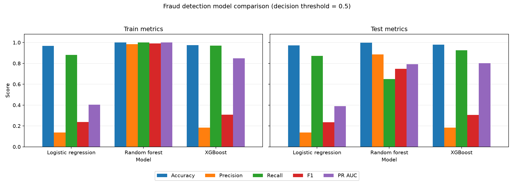
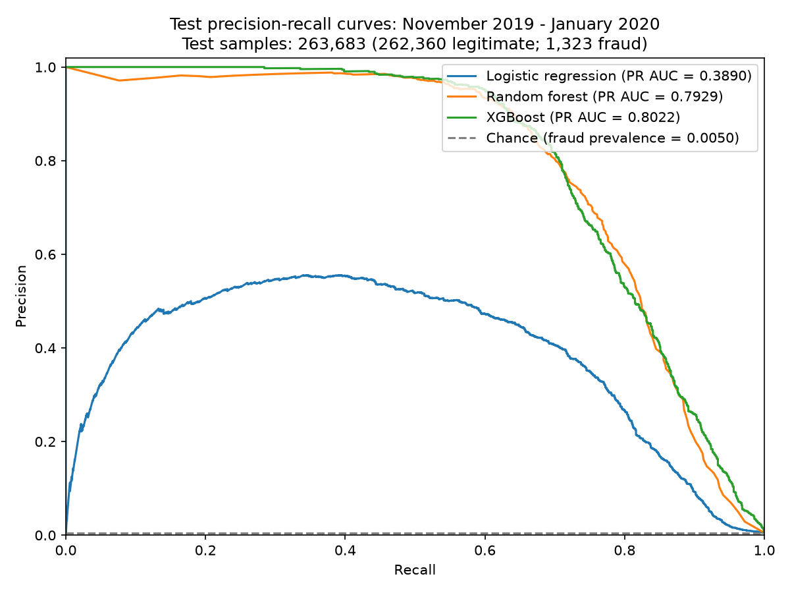
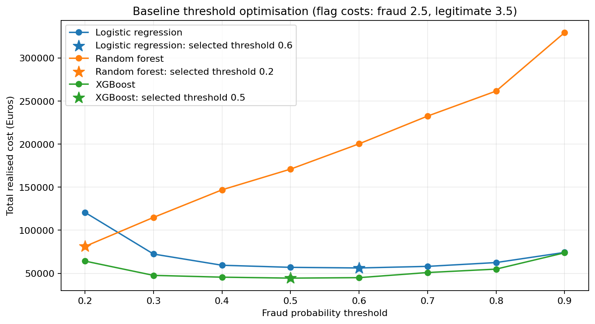
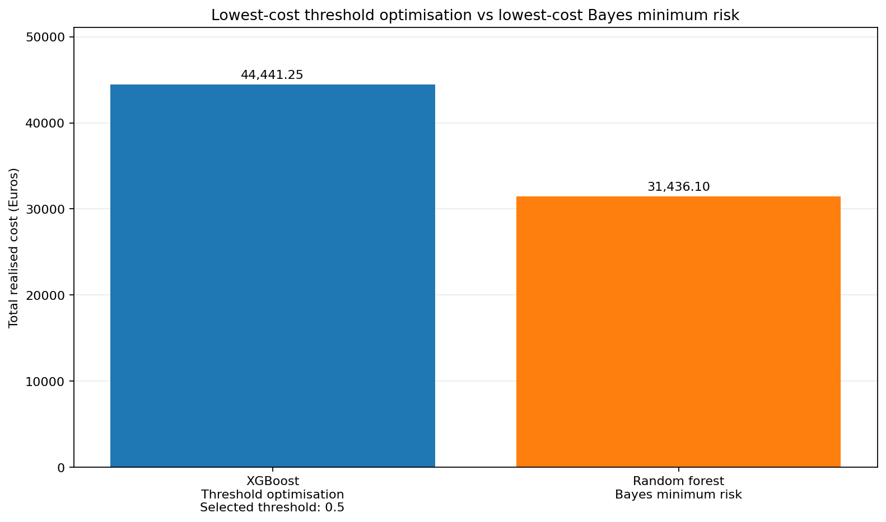
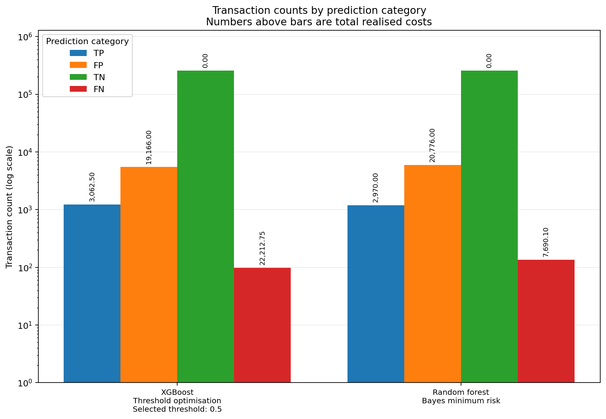
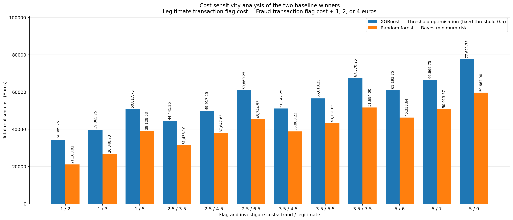

# Cost-sensitive credit card fraud detection

This study compares three machine learning models for detecting credit card fraud. It first checks standard prediction scores, then compares the cost of investigating transactions and missing fraud. Finally, it checks whether the cost results hold when investigation costs change.

The study draws on these two reference papers:

- [Cost Sensitive Credit Card Fraud Detection using Bayes Minimum Risk](https://orbilu.uni.lu/handle/10993/10602)
- [APATE: A novel approach for automated credit card transaction fraud detection using network-based extensions](https://www.scinapse.io/papers/614715210)

[1a_fraud_detection_traditional_models.py](1a_fraud_detection_traditional_models.py) creates features, trains models and measures prediction scores. [2_decision_framework.py](2_decision_framework.py) uses the saved probabilities to compare decision costs.

## 1. Data and time-based train/test split

Each transaction has a date, card number, merchant, amount and fraud label. The label is `is_fraud`: **0 means legitimate and 1 means fraud**. There are many more legitimate transactions than fraudulent ones.

Transactions are split by time:

| Use | Period | Date boundaries |
|---|---|---|
| Earlier history for feature creation | January 2019 | Before training starts |
| Training: 9 months | February to October 2019 | `2019-02-01 <= timestamp < 2019-11-01` |
| Testing: 3 months | November 2019 to January 2020 | `2019-11-01 <= timestamp < 2020-02-01` |

The code loads January 2019 through February 2020. February 2020 is outside both splits. Future transactions cannot affect earlier features.

The input file, `fraudTrain.csv`, is two directory levels above the script folder. Paths are based on the script location, so the working directory does not matter.

## 2. Features based on past transactions

For each transaction, the code looks back over the **last hour**, **last 24 hours** and **last 7 days**. It creates features for two groups:

- **Global:** transactions on the same card, across all merchants.
- **Merchant:** transactions on the same card at the same merchant.

These windows help capture behaviour at different time scales:

| Window | Pattern it helps the model detect |
|---|---|
| Last hour | Sudden bursts of purchases or spending in a short time |
| Last 24 hours | Changes in transaction frequency and spending over a day |
| Last 7 days | Broader recent spending habits, giving context for unusual activity |

This follows [APATE's use of short-, medium- and long-term transaction histories](https://www.eliassi.org/papers/vanvlasselaer_dss2015.pdf) to compare current activity with a customer's past behaviour. The examples above explain the role of the windows in this study; they are not a claim that each window detects only one kind of fraud.

For a transaction at time `t`, the history runs from `t - window` up to, but not including, `t`. Transactions at exactly the current timestamp are excluded. Features are calculated retrospectively: they use only earlier transactions, without future data or fraud labels.

| Feature suffix | What it measures | Value when there is no history in the window |
|---|---|---|
| `is_first` | Whether there are no earlier transactions in the window | 1 |
| `recency_seconds` | Seconds since the latest earlier transaction in the window | 0 |
| `transaction_count` | Number of earlier transactions | 0 |
| `total_amt` | Total value of earlier transactions | 0 |
| `average_amt` | Average value of earlier transactions | 0 |

Two groups times three windows times five measures give **30 history features**. Names include `global_1h_transaction_count` and `merchant_7d_average_amt`. The current transaction amount, `amt`, is also used, giving **31 model inputs**.

The timestamp, transaction identifier (`trans_num`) and label are not model inputs. Card and merchant identifiers are used to group histories. Personal and demographic columns are removed.

Features are created before the time split. This lets earlier training and test transactions provide history for later test transactions, as they would when processing transactions in time order. Test labels are not used to create features.

## 3. Models and standard prediction scores

The data has a severe class imbalance: fraud makes up less than 1% of transactions in both splits. The class counts from the completed model run are:

| Split | Legitimate (`is_fraud = 0`) | Fraud (`is_fraud = 1`) | Total | Fraud share |
|---|---:|---:|---:|---:|
| Training | 657,110 | 3,734 | 660,844 | 0.565% |
| Test | 262,360 | 1,323 | 263,683 | 0.502% |

The models are trained in this order. Logistic regression is the baseline.

| Model | Main settings | Handling class imbalance |
|---|---|---|
| Logistic regression | Standardised inputs; up to 1,000 iterations | `class_weight="balanced"` |
| Random forest | 300 trees | `class_weight="balanced"` |
| XGBoost | 300 boosting rounds; depth 4; learning rate 0.05; row and column sampling 0.8 | `scale_pos_weight = legitimate training count / fraud training count` |

All models use `random_state=1`. Class weights give fraud examples more importance during training because they are rare. Scaling and weights use training data only. No transactions are added or removed to balance the classes. Training weights are separate from the financial costs used later.

The code measures **accuracy, precision, recall and F1** on training and test data at a probability threshold of **0.5**:

- Accuracy: the share of all predictions that are correct. It can look high even when much fraud is missed.
- Precision: the share of flagged transactions that are actually fraud.
- Recall: the share of fraudulent transactions that are flagged.
- F1: a score that combines precision and recall.
- PR AUC: useful measure for imbalanced datasets because it focuses on detecting the rare fraud class while showing the trade-off between catching fraud and raising false alarms. The horizontal reference line shows the mean of the test transactions (chance).





Each model saves `trans_num`, `amt`, `is_fraud` and `fraud_probability` for every test transaction. These files allow cost experiments without retraining. They are stored in `traditional_model_results/`, with names starting with `traditional_model_`.

## 4. Comparing the cost of decisions

Prediction scores do not show the financial cost of false alarms or missed fraud. This stage measures **total realised cost**: the cost of the decisions when checked against the actual labels.

Predicting fraud means flagging and investigating. Predicting legitimate means allowing the transaction. The baseline cost matrix is:

| Actual class | Predict fraud: flag and investigate | Predict legitimate: allow |
|---|---|---|
| Fraud | True positive (TP): 2.50 euros | False negative (FN): full transaction amount |
| Legitimate | False positive (FP): 3.50 euros | True negative (TN): 0 euros |

Investigating a legitimate transaction costs more to represent the extra cost of a false alarm. All amounts are treated as euros; the code does not convert currencies.

```text
Total realised cost
    = TP count * fraud investigation cost
    + FP count * legitimate investigation cost
    + sum of transaction amounts for false negatives
```

True negatives cost zero. Detected fraud costs only the investigation fee. Missed fraud costs the full transaction amount. Probabilities guide decisions, but actual labels and amounts determine realised cost.

### Experiment A: Threshold optimisation (TO)

Each model is tested at thresholds **0.2 through 0.9, in steps of 0.1**. A transaction is flagged when its fraud probability is at least the threshold.

The threshold with the lowest realised cost is selected for each model. If costs tie, the lower threshold is selected. The cheapest model and threshold across all three algorithms becomes the TO winner. Stars in the graph show each algorithm's selected threshold.



### Experiment B: Bayes minimum risk (BMR)

BMR compares the expected cost of allowing a transaction with the expected cost of investigating it. Let `p` be the predicted fraud probability, `v` the transaction amount, `c_f` the fraud investigation cost and `c_l` the legitimate investigation cost:

```text
Risk(allow) = v * p
Risk(flag and investigate) = c_f * p + c_l * (1 - p)
```

Flag the transaction if the investigation risk is less than or equal to the allow risk. Otherwise, allow it. At baseline, `c_f = 2.5` and `c_l = 3.5`.

This decision depends on the transaction amount as well as its fraud probability. BMR therefore does not use one fixed threshold for every transaction. All three algorithms are tested, and the one with the lowest realised cost becomes the BMR winner.

### Comparing the two winners

The final comparison includes only **one TO winner and one BMR winner**:

| Algorithm | Decision framework | Threshold | Baseline realised cost (euros) |
|---|---|---|---:|
| XGBoost | Threshold optimisation | 0.5 | 44,441.25 |
| Random forest | Bayes minimum risk | Based on each transaction's risks | 31,436.10 |

Random forest BMR costs less than XGBoost TO at baseline.



The next graph breaks the decisions into TP, FP, TN and FN. Bar heights show transaction counts on a log scale. Numbers above the bars show the **total cost in euros for each category**. Both counts and costs are saved in the matching CSV.



There was no hyperparameter tuning. This may help explain XGBoost's result, but the study does not prove that tuning would change the winner. Missed transaction amounts, false alarms and the accuracy of predicted probabilities also affect cost. The code does not calibrate probabilities, and class weighting can affect their accuracy as probability estimates.

Recall is still reported in the standard model evaluation. The decision framework uses realised cost and does not calculate or export recall.

## 5. Sensitivity analysis

This experiment checks the same two winners under **12 investigation cost combinations**:

| Fraud transaction flag cost (euros) | Legitimate transaction flag costs (euros) |
|---:|---|
| 1 | 2, 3, 5 |
| 2.5 | 3.5, 4.5, 6.5 |
| 3.5 | 4.5, 5.5, 7.5 |
| 5 | 6, 7, 9 |

The legitimate transaction flag cost is always the fraud transaction flag cost **plus 1, 2, or 4 euros**. The baseline costs of 2.50 and 3.50 euros are included.

XGBoost keeps its selected threshold of **0.5**. Its predictions stay the same, but their costs change. Random forest BMR recalculates risks and decisions for each cost pair. The models are not retrained or reselected, and the TO threshold is not optimised again.



**Random forest BMR has lower realised cost in all 12 combinations.** The result is consistent over the tested range. It does not show what would happen for every possible cost pair or if the TO threshold were selected again for each pair.

## 6. Saved results and study limits

| Location | Contents |
|---|---|
| `traditional_model_results/` | Standard scores, metric graph, precision-recall graph and three test probability files |
| `decision_framework_results/baseline_TO_threshold_search.csv` | Costs for all tested thresholds and algorithms |
| `decision_framework_results/baseline_BMR_results.csv` | BMR results for all three algorithms |
| `decision_framework_results/baseline_TO_BMR_comparison.csv` and `baseline_TO_BMR_winners.csv` | The two winners, their costs and prediction counts |
| `decision_framework_results/baseline_TO_BMR_category_breakdown.csv` | TP, FP, TN and FN counts and costs for both winners |
| `decision_framework_results/sensitivity_TO_BMR_results.csv` | Detailed results for two models across twelve cost pairs |
| `decision_framework_results/sensitivity_TO_BMR_cost_comparison.csv` | Side-by-side costs for each cost pair |

Thresholds and winners were selected using test labels, so these are exploratory results. A stronger follow-up would select models and thresholds on a separate validation period, then check them on a later test period that has not been used for selection. Tuning and probability calibration could also be tested using training and validation data.

To repeat the study, run `1a_fraud_detection_traditional_models.py`, then `2_decision_framework.py`. If the probability files already exist, run only the second script to repeat the cost experiments. Each script overwrites its own exported results.
